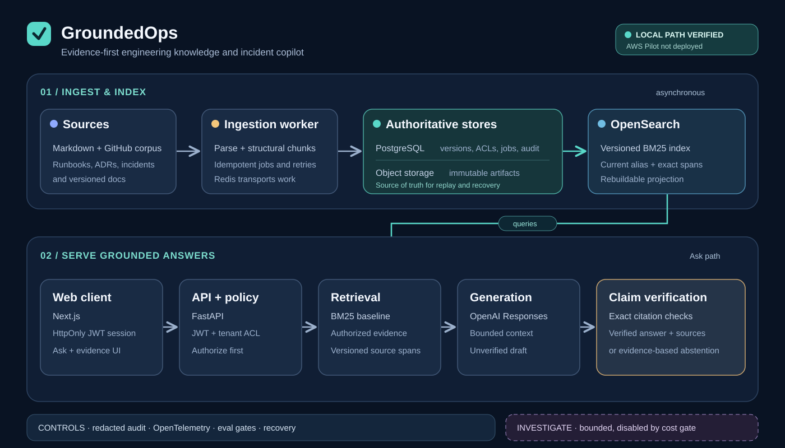

[Português (Brasil)](README.pt-BR.md)

# GroundedOps

**An evidence-first copilot for engineering knowledge and incident response.**

GroundedOps turns versioned technical documents into authorized, cited answers. It
is built around a simple rule: a more complex retrieval or agent workflow is not
enabled until a reproducible evaluation shows that its benefit outweighs its
latency and cost.



## What the system does

- Ingests Markdown-based engineering knowledge, including runbooks, ADRs,
  documentation and curated incident fixtures. Jobs are idempotent and retain
  source version, policy and provenance.
- Searches the current, authorized corpus with BM25. Evidence includes stable
  document versions and exact source spans.
- Streams an `Ask` draft, then returns a verified answer with claim-level
  citations—or abstains when the available evidence is insufficient.
- Provides an evidence-first web interface for Ask, source inspection,
  investigation status lookup and feedback. The API enforces authorization on
  every request; the web session does not replace backend policy checks.

The bounded asynchronous `Investigate` workflow is implemented and evaluated,
but **disabled by default**. Its measured improvement did not meet the approved
cost limit, so ordinary questions stay on the predictable `Ask` path.

## System design

| Layer | Responsibility | Trust boundary |
| --- | --- | --- |
| Ingestion worker | Parse, structurally chunk, deduplicate and index source versions | Source content is untrusted data; failed jobs are observable and recoverable. |
| PostgreSQL + object storage | Keep metadata, policies, job state, audit records and immutable artifacts | These are the authoritative stores. |
| OpenSearch | Serve a versioned BM25 index behind aliases | This is a rebuildable projection, not the source of truth. |
| FastAPI + Next.js | Authenticate, enforce tenant/document policy and expose Search/Ask | Authorization happens before evidence enters model context. |
| Generation + verification | Pack bounded evidence, generate a draft and check each citation against the retrieved spans | Only a verified final answer is presented as grounded. |

OpenTelemetry and redacted audit events make request outcomes, failures and costs
inspectable. The API and ingestion worker are separate processes so interactive
requests do not wait for indexing work. Locally, Docker Compose runs PostgreSQL,
OpenSearch, S3-compatible storage and Redis; the AWS Pilot is defined in Terraform
but has **not** been deployed.

## Decisions backed by evidence

| Decision | Result | Why it matters |
| --- | --- | --- |
| Keep structural chunks and BM25 | [Retrieval evaluation](docs/decisions/ADR-001-retrieval-strategy.md) reached Recall@10 and nDCG@10 of 1.00 on the small v1 set; dense, hybrid and reranking showed no gain. | Complexity is not promoted on intuition. The two-query set is too small to establish general superiority. |
| Use a smaller qualifying generation model | [Answer evaluation](evals/answering/reports/answering-v1.json) selected GPT-4o Mini with 100% task success and citation coverage, zero invalid citations, and 45.76% lower measured cost than the larger baseline on four local cases. | Quality, citations and cost are evaluated together; four cases are not a production-quality guarantee. |
| Keep the agent opt-in | [Agent evaluation](docs/decisions/ADR-002-agent-routing.md) improved multi-hop success from 50% to 62.5%, but cost 2.7× `Ask`, above the 2.5× limit. | A useful capability can still be the wrong default. |
| Require release evidence | The latest local release gate passed 417 Python tests, 8 web unit tests and 8 browser E2E tests; see the [task evidence](.specs/features/production-rag-platform/tasks.md). | Tests, accessibility and operational checks are part of delivery, not post-hoc polish. |

These are versioned, bounded evaluations. Their dataset sizes and local latency
conditions are documented in the linked reports; they do not represent live
production traffic.

## Run locally

Requirements: Python 3.13 with `uv`, Docker Compose, Node.js 24 and npm. Create a
local `.env` from [`.env.example`](.env.example) and replace its placeholders;
never commit credentials. Configure an OpenAI key and JWT issuer, audience and
verification key to use protected Search/Ask routes. Without them, liveness can
work while readiness correctly remains unavailable.

```sh
uv sync --locked --all-groups
docker compose up -d --wait postgres opensearch minio redis minio-init
docker compose run --rm worker python -m grounded_ops.worker migrate
docker compose up -d api worker
docker compose exec worker python -m grounded_ops.worker submit-corpus /corpus --tenant demo --policy public
```

The [worker runbook](docs/ingestion-worker.md) explains retries and recovery. For
the web preview, set `API_BASE_URL=http://127.0.0.1:8000` in an ignored
`web/.env.local` (see [`web/.env.example`](web/.env.example)), then run:

```sh
npm ci --prefix web
npm --prefix web run dev
```

Enter a valid API JWT in the session form. It is stored in a server-set HttpOnly
cookie, not browser storage. This local flow is **not** a hosted identity-provider
login. The interface can inspect an investigation by ID, but starting new
investigations remains unavailable while the agent route is disabled.

## Verification and project status

`make check` covers formatting, lint, types and unit tests. `make pre-push` adds
the full Python suite, coverage, web typecheck/tests/build, diff coverage, secret
scanning and quality-floor checks. `make release-check` also runs browser E2E,
accessibility and performance checks plus the release test selection. Integration
tests use disposable Docker services.

The application and local UI have been exercised; the [AWS Pilot](infra/staging/README.md)
remains a separate, time-boxed validation. No claim of live AWS operation,
production availability or tested cloud recovery is made yet. The Pilot requires
a reviewed HTTPS entry point, cost estimate and explicit approval before any
billable resources are created.

Further detail: [product specification](.specs/features/production-rag-platform/spec.md),
[architecture design](.specs/features/production-rag-platform/design.md),
[development plan](.specs/features/production-rag-platform/tasks.md),
[quality contract](CONSTRAINTS.md) and [recovery runbook](ops/recovery/runbook.md).
