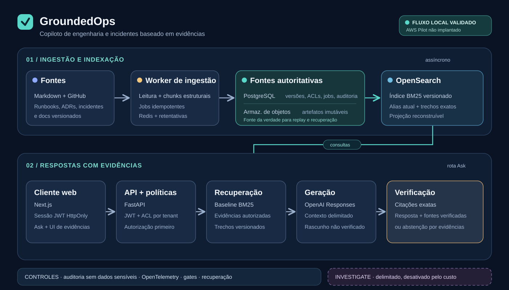

[English](README.md)

# GroundedOps

**Um copiloto baseado em evidências para conhecimento de engenharia e resposta a incidentes.**

O GroundedOps transforma documentos técnicos versionados em respostas autorizadas e
com citações. O projeto segue uma regra simples: um fluxo de recuperação ou de
agentes mais complexo só é ativado quando uma avaliação reproduzível mostra que
seu benefício compensa a latência e o custo adicionais.



## O que o sistema faz

- Ingere conhecimento de engenharia em Markdown, incluindo runbooks, ADRs,
  documentação e exemplos selecionados de incidentes. Os jobs são idempotentes
  e preservam a versão, a política de acesso e a procedência da fonte.
- Pesquisa o corpus atual e autorizado usando BM25. As evidências incluem versões
  estáveis dos documentos e trechos exatos das fontes.
- Transmite um rascunho pela rota `Ask` e depois entrega uma resposta verificada,
  com citações por afirmação — ou se abstém quando as evidências são insuficientes.
- Oferece uma interface web centrada em evidências para perguntas, inspeção de
  fontes, consulta do estado de investigações e feedback. A API verifica a
  autorização a cada requisição; a sessão web não substitui as políticas do backend.

O fluxo assíncrono e delimitado `Investigate` foi implementado e avaliado, mas
fica **desativado por padrão**. A melhoria medida não atingiu o limite de custo
aprovado; por isso, perguntas comuns permanecem na rota `Ask`, mais previsível.

## Arquitetura do sistema

| Camada | Responsabilidade | Limite de confiança |
| --- | --- | --- |
| Worker de ingestão | Interpretar, dividir estruturalmente, deduplicar e indexar versões das fontes | O conteúdo das fontes é dado não confiável; falhas nos jobs são observáveis e recuperáveis. |
| PostgreSQL + armazenamento de objetos | Manter metadados, políticas, estado dos jobs, registros de auditoria e artefatos imutáveis | São as fontes de dados autoritativas. |
| OpenSearch | Servir um índice BM25 versionado por trás de aliases | É uma projeção reconstruível, não a fonte da verdade. |
| FastAPI + Next.js | Autenticar, aplicar políticas por tenant/documento e expor Search/Ask | A autorização ocorre antes de as evidências entrarem no contexto do modelo. |
| Geração + verificação | Reunir evidências dentro de um limite, gerar um rascunho e conferir cada citação com os trechos recuperados | Só uma resposta final verificada é apresentada como fundamentada em evidências. |

OpenTelemetry e eventos de auditoria com dados sensíveis ocultos permitem inspecionar
resultados, falhas e custos das requisições. A API e o worker de ingestão rodam em
processos separados para que as requisições interativas não esperem pela indexação.
Localmente, Docker Compose executa PostgreSQL, OpenSearch, armazenamento compatível
com S3 e Redis; o AWS Pilot está definido em Terraform, mas **não foi implantado**.

## Decisões sustentadas por evidências

| Decisão | Resultado | Por que importa |
| --- | --- | --- |
| Manter chunks estruturais e BM25 | A [avaliação de recuperação](docs/decisions/ADR-001-retrieval-strategy.md) alcançou Recall@10 e nDCG@10 de 1,00 no pequeno conjunto v1; dense, hybrid e reranking não trouxeram ganho. | Complexidade não é adotada por intuição. Duas consultas são insuficientes para demonstrar superioridade geral. |
| Usar um modelo de geração menor que atendeu aos critérios | A [avaliação de respostas](evals/answering/reports/answering-v1.json) selecionou o GPT-4o Mini, com 100% de sucesso nas tarefas e de cobertura de citações, nenhuma citação inválida e custo medido 45,76% menor que o baseline maior em quatro casos locais. | Qualidade, citações e custo são avaliados juntos; quatro casos não garantem qualidade em produção. |
| Deixar o agente como opt-in | A [avaliação do agente](docs/decisions/ADR-002-agent-routing.md) elevou o sucesso em tarefas multi-hop de 50% para 62,5%, mas custou 2,7 vezes o `Ask`, acima do limite de 2,5 vezes. | Uma funcionalidade útil ainda pode ser a escolha errada como padrão. |
| Exigir evidências antes de uma release | O último gate local de release passou em 417 testes Python, 8 testes unitários web e 8 testes E2E no navegador; veja os [resultados da task](.specs/features/production-rag-platform/tasks.md). | Testes, acessibilidade e verificações operacionais fazem parte da entrega, não são retoques posteriores. |

Essas avaliações são versionadas e têm escopo limitado. Os tamanhos dos conjuntos
de dados e as condições de latência local estão documentados nos relatórios
indicados; os resultados não representam tráfego real de produção.

## Executar localmente

Requisitos: Python 3.13 com `uv`, Docker Compose, Node.js 24 e npm. Crie um `.env`
local a partir de [`.env.example`](.env.example) e substitua os valores de exemplo;
nunca faça commit de credenciais. Configure uma chave da OpenAI e o emissor,
a audiência e a chave de verificação JWT para usar as rotas protegidas Search/Ask.
Sem isso, o liveness pode funcionar enquanto o readiness, corretamente, permanece
indisponível.

```sh
uv sync --locked --all-groups
docker compose up -d --wait postgres opensearch minio redis minio-init
docker compose run --rm worker python -m grounded_ops.worker migrate
docker compose up -d api worker
docker compose exec worker python -m grounded_ops.worker submit-corpus /corpus --tenant demo --policy public
```

O [runbook do worker](docs/ingestion-worker.md) explica novas tentativas e
recuperação. Para visualizar a interface web, defina
`API_BASE_URL=http://127.0.0.1:8000` em `web/.env.local`, que é ignorado pelo Git
(veja [`web/.env.example`](web/.env.example)), e execute:

```sh
npm ci --prefix web
npm --prefix web run dev
```

Informe um JWT válido no formulário de sessão. Ele é armazenado em um cookie
HttpOnly definido pelo servidor, não no armazenamento do navegador. Esse fluxo
local **não** é um login com provedor de identidade hospedado. A interface permite
consultar uma investigação pelo ID, mas iniciar novas investigações continua
indisponível enquanto a rota do agente estiver desativada.

## Verificação e estado do projeto

`make check` verifica formatação, lint, tipos e testes unitários. `make pre-push`
acrescenta a suíte Python completa, cobertura, verificação de tipos, testes e build
da interface web, cobertura das linhas alteradas, detecção de segredos e verificações
do contrato mínimo de qualidade. `make release-check` também executa testes E2E no
navegador, verificações de acessibilidade e desempenho e a seleção de testes de
release. Os testes de integração usam serviços Docker descartáveis.

A aplicação e a interface local já foram exercitadas; o [AWS Pilot](infra/staging/README.md)
continua sendo uma validação separada, com tempo limitado. Ainda não há alegação
de operação ativa na AWS, disponibilidade em produção ou recuperação em nuvem
testada. O Pilot exige um ponto de entrada HTTPS revisado, estimativa de custo e
aprovação explícita antes da criação de qualquer recurso cobrável.

Mais detalhes: [especificação do produto](.specs/features/production-rag-platform/spec.md),
[desenho da arquitetura](.specs/features/production-rag-platform/design.md),
[plano de desenvolvimento](.specs/features/production-rag-platform/tasks.md),
[contrato de qualidade](CONSTRAINTS.md) e [runbook de recuperação](ops/recovery/runbook.md).
